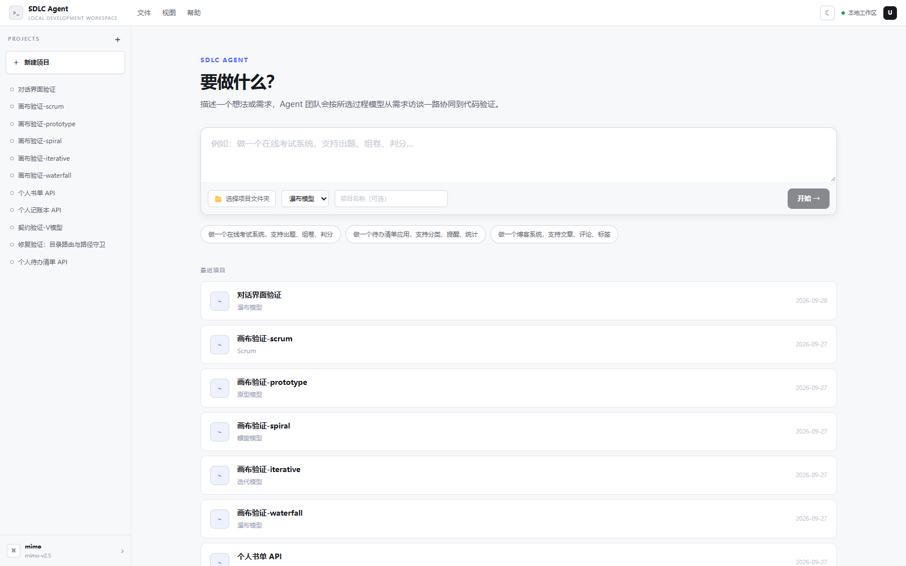
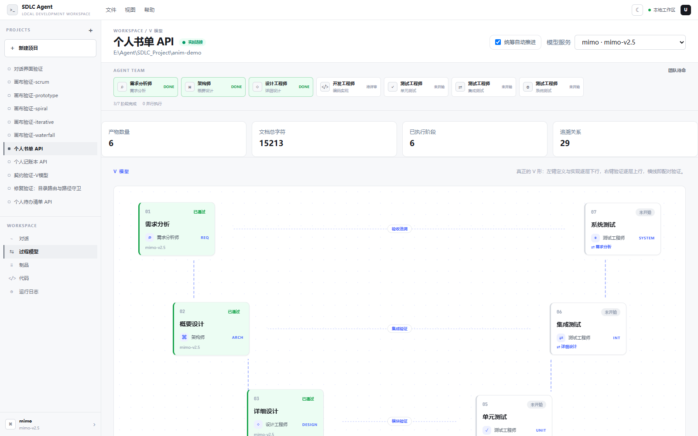
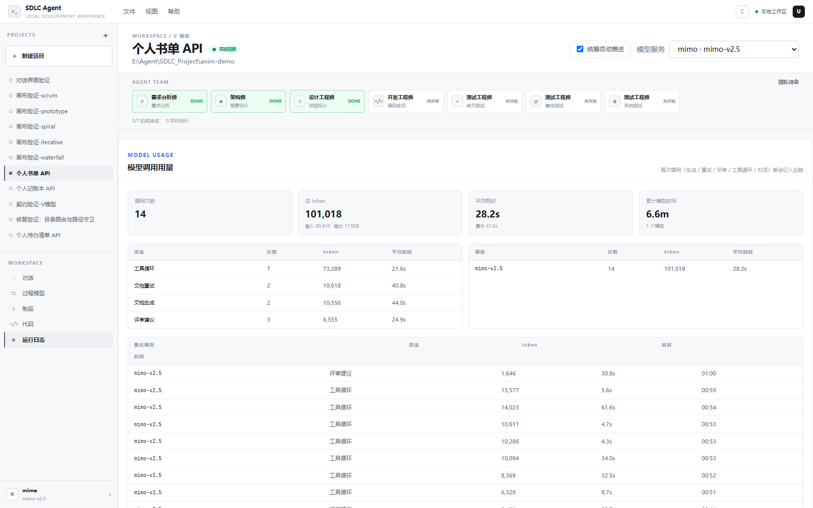
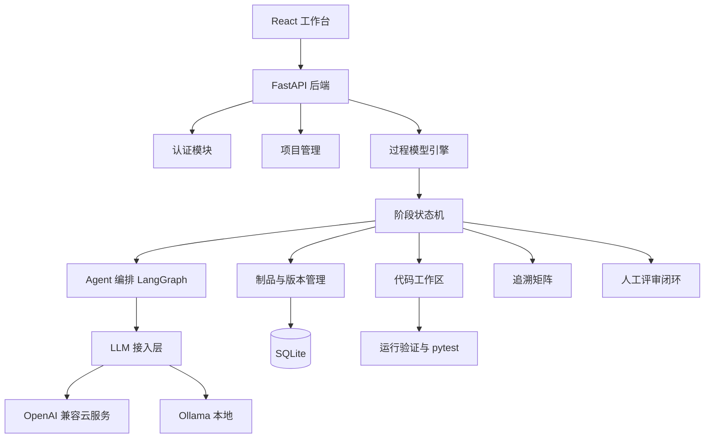

# SDLC Agent

<p>
  
  
  
  
  
</p>

基于大语言模型多智能体的**软件生命周期智能协作平台**。创建项目并选择开发过程模型后，
系统模拟一支开发团队逐阶段推进：每个阶段产出可评审文档，编码与测试阶段真实写盘、运行验证，
最终交付可运行的代码与完整的过程轨迹。

> 定位：**本地单机运行的 Agent 编程工作台**（对标 Codex / OpenCode 一类工具的本地形态），
> 数据、代码与虚拟环境都落在你自己的磁盘上，不依赖任何托管服务。

## 界面预览

| 项目入口 | 过程模型画布 |
| --- | --- |
|  |  |

| 运行日志（Agent 活动时间线） |
| --- |
|  |

## 核心特性

- **六种过程模型**：瀑布、V 模型、迭代、螺旋、原型、Scrum，且**行为真正不同**
  （阶段契约决定输入裁剪、实体配额、配对验证），不只是阶段改名。
- **多 Agent 协作**：需求分析师 / 架构师 / 设计 / 开发 / 测试 / 评审等角色，
  各自拥有工具子集与权限策略（评审角色无写权限）。
- **阶段双模式**：文档类阶段支持「对话模式」逐轮沟通生成，或「自动模式」直接生成；
  编码/测试类阶段执行「写盘 → 运行验证 → 修复」工具循环。
- **真实代码闭环**：代码写入项目文件夹，独立虚拟环境、运行验证与 pytest。
- **人工评审关卡**：评审 Agent 输出结构化检查清单，人工逐项判定，存在未通过项禁止放行。
- **实时与可观测**：SSE 事件流（阶段状态、工具调用、消息增量）、模型调用台账（token/耗时/用途）。
- **追溯矩阵**：解析 RQ/UC/MOD/TC 建立追溯关系，输出覆盖率与未定义引用提示。
- **本地工作区能力**：项目级 Git 工作流、MCP Server 配置与工具发现、`SKILL.md` 规则加载、
  Agent 权限配置。

## 支持的开发模型

| 模型 | 阶段序列 |
| --- | --- |
| 瀑布 | 需求分析 → 概要设计 → 详细设计 → 编码骨架 → 测试计划与用例 |
| V 模型 | 需求 → 概要设计 → 详细设计 → 编码实现 → 单元测试 → 集成测试 → 系统测试 |
| 迭代 | 需求 → 概要设计 → 详细设计 → 编码实现 → 测试验证 → 迭代评审 |
| 螺旋 | 需求 → 风险分析 → 概要设计 → 编码实现 → 测试验证 → 阶段评估 |
| 原型 | 需求 → 原型构建 → 用户反馈 → 需求精化 → 编码实现 → 测试验证 |
| Scrum | 产品待办 → Sprint 计划 → Sprint 开发 → Sprint 评审 → Sprint 回顾 |

工作台的「过程模型」标签以**画布视图**呈现各模型形态：V 模型是真正的 V 形、瀑布是阶梯 + 回溯弧、
螺旋环绕风险枢纽、Scrum 是闭环；节点上直接展示执行角色、模型、实时工具调用、并行通道与上下文规模。

## 架构



**技术栈**：FastAPI + SQLAlchemy + LangGraph + SQLite（后端）；React 18 + TypeScript + Vite + Tailwind v4（前端）；
Electron + 内置便携 CPython（桌面绿色包）。

## 快速开始

### 环境要求

| 依赖 | 版本 |
| --- | --- |
| Python | 3.10 及以上 |
| Node.js | 18 及以上（含 npm） |

### 一键启动（开发）

```powershell
# 首次安装依赖
cd backend;  python -m venv .venv; .\.venv\Scripts\Activate.ps1; pip install -r requirements.txt
cd ..\frontend; npm install

# 启动前后端（后台隐藏进程）
.\scripts\dev.ps1
```

- 后端 http://127.0.0.1:8000 ｜ 前端 http://127.0.0.1:5173

### 首次使用

1. 打开 http://127.0.0.1:5173
2. 进入「模型服务」添加一个 Provider
   - OpenAI 兼容云服务：填写 Base URL、API Key、默认模型
   - 本地 Ollama：`http://127.0.0.1:11434/v1`，API Key 可留空
3. 回到「项目」新建项目，选择开发模型与本地文件夹
4. 启动需求阶段（对话模式或自动生成），按阶段评审逐步推进

> 未配置 Provider 时阶段无法启动，页面会给出提示。

### 手动启动

```powershell
# 后端
cd backend; .\.venv\Scripts\Activate.ps1; uvicorn app.main:app --reload --port 8000

# 前端（另开终端）
cd frontend; npm run dev
```

- 健康检查 http://127.0.0.1:8000/api/health ｜ 接口文档 http://127.0.0.1:8000/docs

### 停止服务

`dev.ps1` 以后台隐藏进程启动：

```powershell
# 关闭后端（8000）
$id = (Get-NetTCPConnection -LocalPort 8000 -ErrorAction SilentlyContinue).OwningProcess
if ($id) { Stop-Process -Id $id -Force }

# 关闭前端（5173）
$id = (Get-NetTCPConnection -LocalPort 5173 -ErrorAction SilentlyContinue).OwningProcess
if ($id) { Stop-Process -Id $id -Force }
```

### 常用命令

```powershell
# 后端测试
cd backend; .\.venv\Scripts\Activate.ps1; pytest -q

# 前端类型检查 + 生产构建
cd frontend; npm run build
```

## 打包为桌面应用（免安装）

仓库内置打包脚本，可产出**单文件绿色应用**（内置便携 Python 与后端，目标机无需安装任何依赖）。

```powershell
.\scripts\package-portable.ps1
```

产物：

- 单文件应用：`desktop/release/SDLC-Agent.exe`（双击即用，免安装）
- 便携文件夹：`desktop/release/win-unpacked/`
- 便携压缩包：`release/SDLC-Agent-portable-win-x64.zip`

首次运行会解压到 `%LOCALAPPDATA%\SDLC-Agent\<版本>`，之后直接启动；
用户数据（数据库、项目工作区）位于 `%APPDATA%\SDLC-Agent`。

> 目标平台：Windows 10（1809+）/ 11 x64。

## 目录结构

```text
SDLC-Agent/
├─ backend/
│  ├─ app/            FastAPI 应用（api / services / models / schemas / core）
│  ├─ tests/          后端测试
│  └─ requirements.txt
├─ frontend/          React 工作台（Vite + Tailwind v4）
├─ desktop/           Electron 桌面壳与打包配置
├─ scripts/           开发与打包脚本（dev / build / package-portable）
├─ docs/              界面截图
└─ README.md
```

## 安全说明

- 本项目会**执行子进程、生成并运行代码、读写本地文件**，请**仅在本地受信环境使用，切勿直接暴露到公网**。
- 开发环境（`ENV=development`）开箱即用：未携带 token 时自动降级为内置 `local` 用户。
- 部署到非开发环境前必须显式设置 `SECRET_KEY`（使用内置默认密钥会**拒绝启动**），
  且会自动关闭本地用户兜底与不安全命令；可选变量见 `backend/.env.example`。
- Provider `base_url`、目录浏览等均有白名单/根目录限制（`ALLOWED_PROVIDER_HOSTS`、`FS_BROWSE_ROOT`）。

## 项目工作区能力

项目文件夹内支持一组接近 Codex / OpenCode 的本地能力：

- **Git 工作流**：查看状态 / Diff / 提交历史，创建提交；阶段产物可自动提交。
- **MCP Server**：`<project>/.sdlc/mcp.json` 配置本地 stdio Server，按需发现工具（配置读取不执行命令）。
- **Agent 配置**：`<project>/.sdlc/agents.json` 定义角色与 `read/edit/bash/git` 权限。
- **Project Skills**：`<project>/.sdlc/skills/<name>/SKILL.md` 提供项目规则，仅作为上下文加载，不执行脚本。
