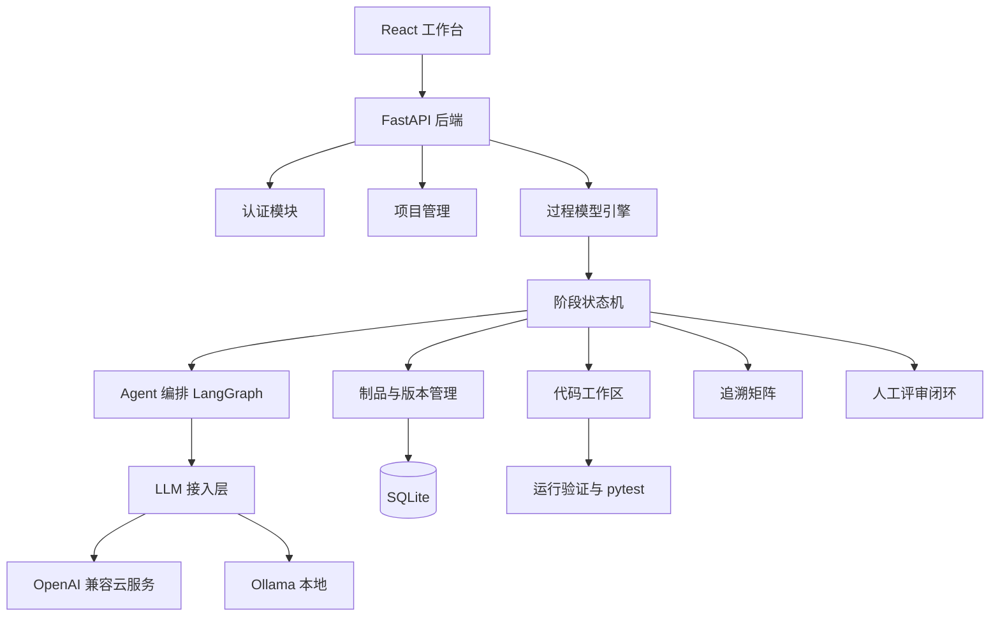

# SDLC Agent

基于大语言模型多智能体的软件生命周期智能协作平台。用户创建项目后选择开发模型，系统模拟开发团队逐阶段推进，每个阶段产出可评审文档，最终生成并验证可运行代码。

## 总体架构



## 核心模块

| 模块 | 职责 |
| --- | --- |
| 认证 | 用户注册、登录、JWT 鉴权 |
| 项目管理 | 项目 CRUD、过程模型选择、流程状态 |
| 过程模型引擎 | 配置化阶段定义，支持瀑布、V 模型、迭代、螺旋、原型、Scrum 六种模型 |
| 阶段状态机 | 阶段运行状态、产物与评审流转 |
| Agent 编排 | LangGraph 节点执行、需求访谈、文档生成 |
| LLM 接入层 | OpenAI 兼容云服务与 Ollama，用户自带 Key |
| 制品管理 | 文档版本、人工编辑、Markdown/Word/PDF 导出 |
| 评审闭环 | 产物通过/打回、评审意见、重新生成 |
| 追溯矩阵 | 解析 RQ/UC/MOD/TC 实体并输出覆盖提示 |
| 代码生成 | 真实代码落盘、独立虚拟环境、运行验证、pytest |

## 支持的开发模型

### 瀑布模型

需求分析 → 概要设计 → 详细设计 → 编码骨架 → 测试计划与用例

### V 模型

需求分析 → 概要设计 → 详细设计 → 编码实现 → 单元测试 → 集成测试 → 系统测试

V 模型将开发阶段与验证阶段对应，编码与测试能力复用同一套代码运行闭环。

### 迭代模型

需求分析 → 概要设计 → 详细设计 → 编码实现 → 测试验证 → 迭代评审

将开发过程分为多个迭代周期，每个迭代完成需求、设计、编码、测试与评审。

### 螺旋模型

需求分析 → 风险分析 → 概要设计 → 编码实现 → 测试验证 → 阶段评估

以风险驱动为核心，每轮螺旋包含需求、风险分析、设计、编码、测试与评估。

### 原型模型

需求分析 → 原型构建 → 用户反馈 → 需求精化 → 编码实现 → 测试验证

先快速构建原型获取用户反馈，精化需求后再进行正式编码与测试。

### Scrum

产品待办列表 → Sprint 计划 → Sprint 开发 → Sprint 评审 → Sprint 回顾

敏捷开发框架，以 Sprint 为迭代单元，包含计划、开发、评审与回顾。

## 代码生成闭环

1. 编码阶段将代码文件真实写入 `backend/data/projects/{project_id}/code/`。
2. 每个生成项目使用独立虚拟环境，避免污染平台环境。
3. 依赖安装只保留包名，忽略模型生成的旧版本号。
4. 运行验证包含语法检查、启动验证、pytest 测试。
5. M9 工具化编码 Agent 支持工具循环：

```text
list_files
read_file
write_file
edit_file
run_command
run_tests
```

Agent 反复执行“写文件 → 运行验证 → 查看错误 → 修改”直到测试通过。

## 目录结构

```text
SDLC-Agent/
├─ backend/
│  ├─ app/
│  │  ├─ api/          API 路由
│  │  ├─ core/         配置
│  │  ├─ db/           数据库会话
│  │  ├─ models/       数据模型
│  │  ├─ schemas/      Pydantic 模型
│  │  ├─ services/     业务服务
│  │  └─ main.py       应用入口
│  ├─ data/
│  │  ├─ sdlc.db       本地数据库
│  │  └─ projects/     生成代码工作区
│  ├─ alembic/         数据库迁移
│  └─ tests/           后端测试
├─ frontend/
│  └─ src/
│     ├─ components/   组件
│     ├─ lib/          API 封装
│     ├─ pages/        页面
│     └─ store/        前端状态
├─ docs/               设计与验证文档
└─ scripts/            开发与演示脚本
```

## 快速开始

本项目为本地单机运行，所有数据（数据库、生成的代码）都写在仓库内的 `backend/data/`。

### 环境要求

| 依赖 | 版本 |
| --- | --- |
| Python | 3.10 及以上 |
| Node.js | 18 及以上（含 npm） |

### 一键启动

```powershell
.\scripts\dev.ps1
```

脚本会在后台同时拉起后端与前端：

- 后端 http://127.0.0.1:8000
- 前端 http://127.0.0.1:5173

> 首次运行前请先完成下面的「首次安装」，否则会因缺少依赖而启动失败。

### 首次安装

后端：

```powershell
cd backend
python -m venv .venv
.\.venv\Scripts\Activate.ps1
pip install -r requirements.txt
```

前端：

```powershell
cd frontend
npm install
```

### 手动启动

后端（需先激活虚拟环境）：

```powershell
cd backend
.\.venv\Scripts\Activate.ps1
uvicorn app.main:app --reload --port 8000
```

前端（另开一个终端）：

```powershell
cd frontend
npm run dev
```

- 健康检查：http://127.0.0.1:8000/api/health
- 接口文档：http://127.0.0.1:8000/docs
- 前端页面：http://127.0.0.1:5173

后端启动时会自动建表，并初始化 6 种过程模型与 agent 角色。

### 首次使用

1. 打开 http://127.0.0.1:5173
2. 进入「模型服务」，添加一个 Provider
   - OpenAI 兼容云服务：填写 Base URL、API Key、默认模型
   - 本地 Ollama：`http://127.0.0.1:11434/v1`，API Key 可留空
3. 回到「项目」新建项目，选择开发模型与本地文件夹
4. 启动需求阶段（访谈模式或自动生成），按阶段评审逐步推进

未配置 Provider 时阶段无法启动，页面会给出提示。

### 常用命令

```powershell
# 后端测试
cd backend
.\.venv\Scripts\Activate.ps1
pytest -q

# 前端类型检查 + 生产构建
cd frontend
npm run build

# 预览构建产物
npm run preview
```

### 关于登录

本地单机运行无需注册登录：请求未携带 token 时，后端自动使用内置 `local` 用户。
只有当 `ENV` 设为非 `development` 时才会强制鉴权，详见下方「安全配置」。

## 安全配置

开发环境（`ENV=development`）开箱即用，未携带 token 时自动降级为内置 `local` 用户。

部署到非开发环境前必须注意：

- 必须显式设置 `SECRET_KEY`，使用内置默认密钥会**拒绝启动**。
  ```powershell
  python -c "import secrets;print(secrets.token_urlsafe(48))"
  ```
- 非开发环境会**自动关闭**本地用户兜底（`ALLOW_LOCAL_USER_FALLBACK`）与不安全命令
  （`ALLOW_UNSAFE_COMMANDS`），JWT 失效即返回 401。
- `SECRET_KEY` 同时用于 JWT 签名和 Provider API Key 加密，更换后既有 token 与已存密钥会失效。

其余可选项见 `backend/.env.example`：

| 变量 | 说明 |
| --- | --- |
| `ALLOWED_PROVIDER_HOSTS` | Provider `base_url` 主机名白名单，留空只拦截链路本地等危险地址 |
| `FS_BROWSE_ROOT` | 目录浏览接口的根目录限制，留空表示不限制 |

编码 Agent 的命令执行默认受限：仅允许 `python <工作区内脚本>`、`pytest`、`pip install/uninstall/list/show`，
禁止 `python -c` 与自定义 pip 源；子进程使用最小化环境变量，不会继承平台 `SECRET_KEY`。

## 当前状态

- M0：项目骨架
- M1：注册登录、项目管理、瀑布模型种子数据
- M2：LLM Provider 管理，支持 OpenAI 兼容云服务和 Ollama
- M3：Agent 执行引擎，阶段运行、LangGraph 编排、产物保存
- M4：需求访谈对话、确认生成、评审通过/打回闭环
- M5：前端工作台完善，流程动效、活动日志、文档编辑、Provider 选择
- M6：追溯矩阵、Word/PDF 导出、统计看板
- M7：在线考试系统完整案例验证
- M8：可运行代码生成与验证
- M9：工具化编码 Agent 循环
- 新增 V 模型：7 阶段开发与验证对应流程
- 迭代模型、螺旋模型、原型模型、Scrum

## 文档

- 软件生命周期智能协作平台-详细设计.md
- 实施计划.md
- docs/M7-案例验证.md
- docs/M8-可运行代码生成.md
