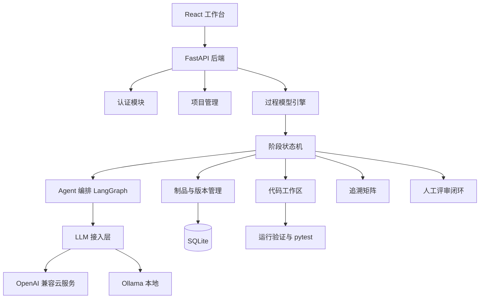

# SDLC Agent

基于大语言模型多智能体的软件生命周期智能协作平台。用户创建项目后选择开发模型，系统模拟开发团队逐阶段推进，每个阶段产出可评审文档，最终生成并验证可运行代码。

## 总体架构



## 核心模块

| 模块 | 职责 |
| --- | --- |
| 认证 | 用户注册、登录、JWT 鉴权 |
| 项目管理 | 项目 CRUD、过程模型选择、流程状态 |
| 过程模型引擎 | 配置化阶段定义，当前支持瀑布模型与 V 模型 |
| 阶段状态机 | 阶段运行状态、产物与评审流转 |
| Agent 编排 | LangGraph 节点执行、需求访谈、文档生成 |
| LLM 接入层 | OpenAI 兼容云服务与 Ollama，用户自带 Key |
| 制品管理 | 文档版本、人工编辑、Markdown/Word/PDF 导出 |
| 评审闭环 | 产物通过/打回、评审意见、重新生成 |
| 追溯矩阵 | 解析 RQ/UC/MOD/TC 实体并输出覆盖提示 |
| 代码生成 | 真实代码落盘、独立虚拟环境、运行验证、pytest |

## 支持的开发模型

### 瀑布模型

需求分析 → 概要设计 → 详细设计 → 编码骨架 → 测试计划与用例

### V 模型

需求分析 → 概要设计 → 详细设计 → 编码实现 → 单元测试 → 集成测试 → 系统测试

V 模型将开发阶段与验证阶段对应，编码与测试能力复用同一套代码运行闭环。

## 代码生成闭环

1. 编码阶段将代码文件真实写入 `backend/data/projects/{project_id}/code/`。
2. 每个生成项目使用独立虚拟环境，避免污染平台环境。
3. 依赖安装只保留包名，忽略模型生成的旧版本号。
4. 运行验证包含语法检查、启动验证、pytest 测试。
5. M9 工具化编码 Agent 支持工具循环：

```text
list_files
read_file
write_file
edit_file
run_command
run_tests
```

Agent 反复执行“写文件 → 运行验证 → 查看错误 → 修改”直到测试通过。

## 目录结构

```text
SDLC-Agent/
├─ backend/
│  ├─ app/
│  │  ├─ api/          API 路由
│  │  ├─ core/         配置
│  │  ├─ db/           数据库会话
│  │  ├─ models/       数据模型
│  │  ├─ schemas/      Pydantic 模型
│  │  ├─ services/     业务服务
│  │  └─ main.py       应用入口
│  ├─ data/
│  │  ├─ sdlc.db       本地数据库
│  │  └─ projects/     生成代码工作区
│  ├─ alembic/         数据库迁移
│  └─ tests/           后端测试
├─ frontend/
│  └─ src/
│     ├─ components/   组件
│     ├─ lib/          API 封装
│     ├─ pages/        页面
│     └─ store/        前端状态
├─ docs/               设计与验证文档
└─ scripts/            开发与演示脚本
```

## 快速开始

### 后端

```powershell
cd backend
python -m venv .venv
.\.venv\Scripts\Activate.ps1
pip install -r requirements.txt
uvicorn app.main:app --reload --port 8000
```

健康检查：http://127.0.0.1:8000/api/health

后端启动时会自动建表，并初始化瀑布模型、V 模型与 agent 角色。

### 前端

```powershell
cd frontend
npm install
npm run dev
```

前端地址：http://127.0.0.1:5173

## 当前状态

- M0：项目骨架
- M1：注册登录、项目管理、瀑布模型种子数据
- M2：LLM Provider 管理，支持 OpenAI 兼容云服务和 Ollama
- M3：Agent 执行引擎，阶段运行、LangGraph 编排、产物保存
- M4：需求访谈对话、确认生成、评审通过/打回闭环
- M5：前端工作台完善，流程动效、活动日志、文档编辑、Provider 选择
- M6：追溯矩阵、Word/PDF 导出、统计看板
- M7：在线考试系统完整案例验证
- M8：可运行代码生成与验证
- M9：工具化编码 Agent 循环
- 新增 V 模型：7 阶段开发与验证对应流程

## 文档

- 软件生命周期智能协作平台-详细设计.md
- 实施计划.md
- docs/M7-案例验证.md
- docs/M8-可运行代码生成.md
