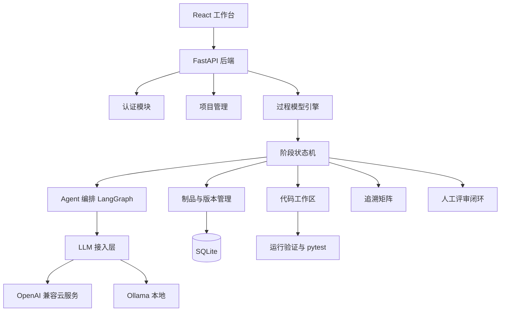

# SDLC Agent

基于大语言模型多智能体的软件生命周期智能协作平台。用户创建项目后选择开发模型，系统模拟开发团队逐阶段推进，每个阶段产出可评审文档，最终生成并验证可运行代码。

## 总体架构



## 核心模块

| 模块 | 职责 |
| --- | --- |
| 认证 | 用户注册、登录、JWT 鉴权 |
| 项目管理 | 项目 CRUD、过程模型选择、流程状态、统筹自动推进开关 |
| 过程模型引擎 | 配置化阶段定义，支持瀑布、V 模型、迭代、螺旋、原型、Scrum 六种模型 |
| 阶段状态机 | 阶段运行状态、产物与评审流转 |
| Agent 编排 | LangGraph 条件图：生成 → 质量校验（不达标回退重试）→ 保存 → 评审 Agent |
| LLM 接入层 | OpenAI 兼容云服务与 Ollama，用户自带 Key，支持流式输出 |
| 制品管理 | 文档版本、人工编辑、Markdown/Word/PDF 导出 |
| 评审闭环 | 评审 Agent 自动检查清单 + 人工通过/打回、评审意见、重新生成 |
| 追溯矩阵 | 解析 RQ/UC/MOD/TC 并落库为追溯关系，输出覆盖率与未定义引用提示 |
| 代码生成 | 真实代码落盘、独立虚拟环境、运行验证、pytest |
| 实时事件 | SSE 推送阶段状态、agent 执行、消息增量、产物保存、评审结果 |

## 阶段参与模式

每个阶段的启动都可选择模式：

- **对话模式**：用户与当前阶段角色 agent 逐轮沟通，确认后整理成阶段文档。适用于所有文档类阶段。
- **自动模式**：agent 直接生成阶段文档，或对编码/测试类阶段执行"写盘 → 运行验证 → 修复"工具循环。

编码/测试类阶段（`coding`、`testing`、`unit-test`、`integration-test`、`system-test`、`prototype`、`sprint-dev`）
需要真实写盘并运行验证，固定使用自动模式。

## 实时事件

`GET /api/projects/{id}/events` 提供 SSE 事件流，前端已用它替代轮询（连接不可用时自动退化为 3 秒轮询）：

| 事件 | 说明 |
| --- | --- |
| `stage_status` | 阶段状态变化（collecting / generating / awaiting_review / approved / …） |
| `agent_started` | agent 开始执行 |
| `message_delta` | 对话回复的流式增量 |
| `message` | 一条完整对话消息已保存 |
| `artifact_saved` | 产物已保存并生成版本 |
| `review_opened` | 进入人工评审 |
| `review_suggested` | 评审 Agent 已输出检查清单建议 |
| `review_result` | 人工评审完成 |
| `stage_completed` | 全部阶段完成 |
| `error` | 阶段执行失败 |

## 统筹自动推进

项目可开启 `auto_advance`（工作台右上角「统筹自动推进」）。开启后，某阶段评审通过会由统筹 Agent
自动启动下一阶段，人工评审关卡仍然保留。

## 支持的开发模型

### 瀑布模型

需求分析 → 概要设计 → 详细设计 → 编码骨架 → 测试计划与用例

### V 模型

需求分析 → 概要设计 → 详细设计 → 编码实现 → 单元测试 → 集成测试 → 系统测试

V 模型将开发阶段与验证阶段对应，编码与测试能力复用同一套代码运行闭环。

### 迭代模型

需求分析 → 概要设计 → 详细设计 → 编码实现 → 测试验证 → 迭代评审

将开发过程分为多个迭代周期，每个迭代完成需求、设计、编码、测试与评审。

### 螺旋模型

需求分析 → 风险分析 → 概要设计 → 编码实现 → 测试验证 → 阶段评估

以风险驱动为核心，每轮螺旋包含需求、风险分析、设计、编码、测试与评估。

### 原型模型

需求分析 → 原型构建 → 用户反馈 → 需求精化 → 编码实现 → 测试验证

先快速构建原型获取用户反馈，精化需求后再进行正式编码与测试。

### Scrum

产品待办列表 → Sprint 计划 → Sprint 开发 → Sprint 评审 → Sprint 回顾

敏捷开发框架，以 Sprint 为迭代单元，包含计划、开发、评审与回顾。

## 代码生成闭环

1. 编码阶段将代码文件真实写入 `backend/data/projects/{project_id}/code/`。
2. 每个生成项目使用独立虚拟环境，避免污染平台环境。
3. 依赖安装只保留包名，忽略模型生成的旧版本号。
4. 运行验证包含语法检查、启动验证、pytest 测试。
5. M9 工具化编码 Agent 支持工具循环：

```text
list_files
read_file
write_file
edit_file
run_command
run_tests
```

Agent 反复执行“写文件 → 运行验证 → 查看错误 → 修改”直到测试通过。

## 目录结构

```text
SDLC-Agent/
├─ backend/
│  ├─ app/
│  │  ├─ api/          API 路由
│  │  ├─ core/         配置
│  │  ├─ db/           数据库会话
│  │  ├─ models/       数据模型
│  │  ├─ schemas/      Pydantic 模型
│  │  ├─ services/     业务服务
│  │  └─ main.py       应用入口
│  ├─ data/
│  │  ├─ sdlc.db       本地数据库
│  │  └─ projects/     生成代码工作区
│  ├─ alembic/         数据库迁移
│  └─ tests/           后端测试
├─ frontend/
│  └─ src/
│     ├─ components/   组件
│     ├─ lib/          API 封装
│     ├─ pages/        页面
│     └─ store/        前端状态
├─ docs/               设计与验证文档
└─ scripts/            开发与演示脚本
```

## 快速开始

本地单机运行。每个项目在**创建时指定的本地文件夹**内自包含产出：

- 代码与测试：`{folder}/code`、`{folder}/tests`
- 阶段文档（需求、设计、测试等）：`{folder}/docs/*.md`
- 虚拟环境：`{folder}/.venv`

平台级数据（用户、模型 Provider、项目索引）保存在仓库 `backend/data/sdlc.db`。

### 环境要求

| 依赖 | 版本 |
| --- | --- |
| Python | 3.10 及以上 |
| Node.js | 18 及以上（含 npm） |

### 一键启动

```powershell
.\scripts\dev.ps1
```

脚本会在后台同时拉起后端与前端：

- 后端 http://127.0.0.1:8000
- 前端 http://127.0.0.1:5173

> 首次运行前请先完成下面的「首次安装」，否则会因缺少依赖而启动失败。

### 停止服务

`dev.ps1` 以后台隐藏进程启动，停止方式取决于运行位置：

- **在启动它的终端**：直接按 `Ctrl+C`。
- **仅关闭后端（8000）**：
  ```powershell
  $id = (Get-NetTCPConnection -LocalPort 8000 -ErrorAction SilentlyContinue).OwningProcess
  if ($id) { Stop-Process -Id $id -Force }
  ```
- **仅关闭前端（5173）**：
  ```powershell
  $id = (Get-NetTCPConnection -LocalPort 5173 -ErrorAction SilentlyContinue).OwningProcess
  if ($id) { Stop-Process -Id $id -Force }
  ```
- 若后端运行于 WSL / Docker 容器内，请在其对应环境执行 `pkill -f uvicorn` 或 `docker stop <容器>`。

### 首次安装

后端：

```powershell
cd backend
python -m venv .venv
.\.venv\Scripts\Activate.ps1
pip install -r requirements.txt
```

前端：

```powershell
cd frontend
npm install
```

### 手动启动

后端（需先激活虚拟环境）：

```powershell
cd backend
.\.venv\Scripts\Activate.ps1
uvicorn app.main:app --reload --port 8000
```

前端（另开一个终端）：

```powershell
cd frontend
npm run dev
```

- 健康检查：http://127.0.0.1:8000/api/health
- 接口文档：http://127.0.0.1:8000/docs
- 前端页面：http://127.0.0.1:5173

后端启动时会自动建表，并初始化 6 种过程模型与 agent 角色。

### 首次使用

1. 打开 http://127.0.0.1:5173
2. 进入「模型服务」，添加一个 Provider
   - OpenAI 兼容云服务：填写 Base URL、API Key、默认模型
   - 本地 Ollama：`http://127.0.0.1:11434/v1`，API Key 可留空
3. 回到「项目」新建项目，选择开发模型与本地文件夹
4. 启动需求阶段（访谈模式或自动生成），按阶段评审逐步推进

未配置 Provider 时阶段无法启动，页面会给出提示。

### 常用命令

```powershell
# 后端测试
cd backend
.\.venv\Scripts\Activate.ps1
pytest -q

# 前端类型检查 + 生产构建
cd frontend
npm run build

# 预览构建产物
npm run preview
```

### 关于登录

本地单机运行无需注册登录：请求未携带 token 时，后端自动使用内置 `local` 用户。
只有当 `ENV` 设为非 `development` 时才会强制鉴权，详见下方「安全配置」。

## 安全配置

开发环境（`ENV=development`）开箱即用，未携带 token 时自动降级为内置 `local` 用户。

部署到非开发环境前必须注意：

- 必须显式设置 `SECRET_KEY`，使用内置默认密钥会**拒绝启动**。
  ```powershell
  python -c "import secrets;print(secrets.token_urlsafe(48))"
  ```
- 非开发环境会**自动关闭**本地用户兜底（`ALLOW_LOCAL_USER_FALLBACK`）与不安全命令
  （`ALLOW_UNSAFE_COMMANDS`），JWT 失效即返回 401。
- `SECRET_KEY` 同时用于 JWT 签名和 Provider API Key 加密，更换后既有 token 与已存密钥会失效。

其余可选项见 `backend/.env.example`：

| 变量 | 说明 |
| --- | --- |
| `ALLOWED_PROVIDER_HOSTS` | Provider `base_url` 主机名白名单，留空只拦截链路本地等危险地址 |
| `FS_BROWSE_ROOT` | 目录浏览接口的根目录限制，留空表示不限制 |

编码 Agent 的命令执行默认受限：仅允许 `python <工作区内脚本>`、`pytest`、`pip install/uninstall/list/show`，
禁止 `python -c` 与自定义 pip 源；子进程使用最小化环境变量，不会继承平台 `SECRET_KEY`。

## Coding Workspace 基础能力

当前项目工作区已支持一组接近 Codex / OpenCode 的本地开发能力：

### Git 工作流

项目代码页提供以下 Git 操作：

```text
POST /api/projects/{id}/code/git/init
GET  /api/projects/{id}/code/git/status
GET  /api/projects/{id}/code/git/diff
GET  /api/projects/{id}/code/git/log
POST /api/projects/{id}/code/git/commit
```

Git 操作只作用于项目自身文件夹：如果项目目录没有直接的 `.git`，状态接口不会误识别父级仓库；初始化后可以在工作区查看变更、Diff、提交历史并创建提交。提交会先执行 `git add -A`，再使用平台的本地提交身份创建 commit。

### MCP Server 配置

项目可在以下任一位置放置 MCP 配置：

```text
<project>/.sdlc/mcp.json
<project>/.opencode/mcp.json
<project>/mcp.json
```

配置示例：

```json
{
  "filesystem": {
    "type": "local",
    "command": ["python", "mcp_server.py"],
    "enabled": true,
    "environment": {"TOKEN": "..."}
  }
}
```

接口：

```text
GET  /api/projects/{id}/mcp
POST /api/projects/{id}/mcp/{server_name}/discover
```

配置读取不会自动执行命令；只有用户在工作区点击「发现工具」时，才会显式启动本地 stdio MCP Server，执行 `initialize` 和 `tools/list`。环境变量只返回键名，不会在 API 响应中暴露值。当前版本提供本地 stdio 工具发现基础，远程 MCP 和 `tools/call` 将在后续 Runtime 阶段接入统一 Agent 工具权限。

### Agent 配置和权限

项目可以使用以下 Agent 配置文件：

```text
<project>/.sdlc/agents.json
<project>/.opencode/agents.json
<project>/agents.json
```

示例：

```json
{
  "agents": {
    "developer": {
      "mode": "primary",
      "model": "provider/code-model",
      "description": "负责代码实现",
      "permissions": {
        "read": "allow",
        "edit": "allow",
        "bash": "ask",
        "git": "ask"
      }
    }
  }
}
```

接口：

```text
GET /api/projects/{id}/agents
```

编码 Agent 已经使用 `read / edit / bash` 权限策略拦截工具；`deny` 会直接阻止工具调用。

### Project Skills

项目可在以下任一目录放置 `SKILL.md`：

```text
<project>/.sdlc/skills/<skill-name>/SKILL.md
<project>/.opencode/skills/<skill-name>/SKILL.md
<project>/skills/<skill-name>/SKILL.md
```

文件使用轻量 Markdown front matter：

```markdown
---
name: python-style
description: Python coding and testing conventions
---

# Python style

Use type hints, small functions, and pytest for behavior changes.
```

接口：

```text
GET /api/projects/{id}/skills
GET /api/projects/{id}/skills/{skill_name}
```

Skill 只作为项目规则和 Agent 上下文加载，不会自动执行其中的脚本。编码 Agent 会按任务关键词加载匹配的 Skills；加载器会限制文件大小、忽略符号链接，并拒绝缺少 `name`、`description` 或正文的无效 Skill。

## 当前状态

- M0：项目骨架
- M1：注册登录、项目管理、瀑布模型种子数据
- M2：LLM Provider 管理，支持 OpenAI 兼容云服务和 Ollama
- M3：Agent 执行引擎，阶段运行、LangGraph 编排、产物保存
- M4：需求访谈对话、确认生成、评审通过/打回闭环
- M5：前端工作台完善，流程动效、活动日志、文档编辑、Provider 选择
- M6：追溯矩阵、Word/PDF 导出、统计看板
- M7：在线考试系统完整案例验证
- M8：可运行代码生成与验证
- M9：工具化编码 Agent 循环
- 新增 V 模型：7 阶段开发与验证对应流程
- 迭代模型、螺旋模型、原型模型、Scrum
- M10：编排与实时化升级
  - SSE 事件流替代轮询（含流式消息增量）
  - 评审 Agent：LangGraph 新增评审节点，自动输出检查清单与一致性建议
  - 阶段双模式：所有文档类阶段均可对话生成，编码类阶段固定自动
  - LangGraph 条件图：生成质量校验不达标自动回退重试
  - 统筹 Agent：评审通过后自动推进下一阶段
  - 追溯矩阵落库为 `traceability_links`，输出覆盖率与未定义引用提示

## 文档

- 软件生命周期智能协作平台-详细设计.md
- 实施计划.md
- docs/M7-案例验证.md
- docs/M8-可运行代码生成.md
