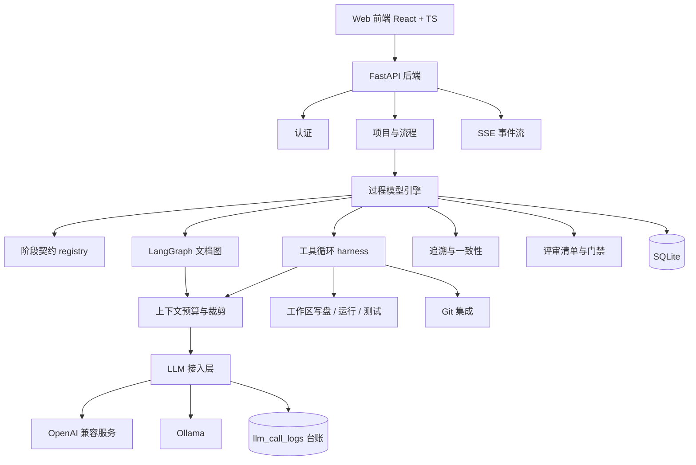

# 软件生命周期智能协作平台 详细设计文档

> 版本：v1.1（实现对齐版）  
> 日期：2026-09-29  
> 状态：与代码一致  
> 变更说明：v0.1 写于实现之前，存在前端选型、导出库、表清单、编排节点四处偏差，
> 且此后新增的六种过程模型契约、并行执行、Git 集成、角色分工、上下文预算、
> 模型调用台账、断点续跑、结构化评审清单均未回写。本版按代码实际实现逐节对齐，
> 附录 A 保留「文档 → 实现」的差异对照。

## 1. 项目概述

### 1.1 背景与目标

本项目面向软件工程毕业设计，构建一个"基于大语言模型多智能体的软件生命周期制品生成与协作平台"。用户以项目发起人身份创建项目，系统模拟软件开发团队，**按选定的过程模型逐阶段推进**，每阶段产出可评审、可修订、可导出的工程文档，并在编码/测试阶段产出**真实可运行的代码与测试**。

核心目标：

1. 需求分析 agent 与用户对话收集需求，输出需求确认清单与需求规格说明书。
2. 阶段支持两种参与模式：自动执行（统筹调度）或直接对话。
3. 每个阶段产出标准工程文档，**必须经人工评审**才允许进入下一阶段。
4. **六种过程模型全部实现**，且通过「阶段契约」产生真实的行为差异（详见 §4.3）。
5. 支持用户自带的 OpenAI 兼容服务与本地 Ollama，调用用量可观测。
6. 编码/测试类阶段由 agent 使用工具真实写盘、运行验证、失败自动修复。

### 1.2 系统角色

| 角色 | 编码 | 说明 |
| --- | --- | --- |
| 统筹协调 | coordinator | 自动模式下调度阶段 agent、汇总上下文 |
| 需求分析师 | requirements_analyst | 访谈用户、整理需求、生成需求文档 |
| 架构师 | architect | 概要设计与模块划分 |
| 设计工程师 | designer | 详细设计、类结构、数据库与接口定义 |
| 开发工程师 | developer | 编码实现：真实写盘、运行验证、修复 |
| 测试工程师 | tester | 测试计划、用例与真实测试执行 |
| 评审 | reviewer | 对产物做清单化审查，**无写权限** |

角色不是提示词标签：`services/agent_roles.py` 为每个角色定义**工具子集、输出契约与写入目标**，
工具门禁在服务端强制（角色子集 → agents.json 权限两道闸）。

### 1.3 设计原则

1. 数据库中的阶段运行状态是唯一事实来源，LangGraph 只负责单个阶段内的执行。
2. 每个阶段必须有用户确认关卡，自动模式也不能跳过。
3. 所有产物可版本化、可人工编辑、可导出、可追溯。
4. LLM 接入层与业务解耦，支持用户自带 key、多模型与**按角色切换模型**。
5. **配置即行为**：过程模型的差异写在契约里并被提示词与校验器共同消费，
   不接受"配置写了、执行没接上"。

## 2. 范围与边界

### 2.1 已实现

- 用户注册、登录、JWT 鉴权；单工作区（登录只标识操作者，不隔离数据）。
- 项目创建（绑定本地工作目录）、项目列表、过程模型画布视图。
- **六种过程模型**：瀑布、V 模型、迭代、螺旋、原型、Scrum，共 19 个阶段定义。
- 阶段契约（输入/输出/配对/行为要求）与按模型差异化的上下文裁剪。
- 需求访谈对话（流式）、阶段产物生成、版本管理、人工评审闭环。
- **结构化评审清单**：19 个阶段的检查项，评审 Agent 逐项判定，人工逐项确认，
  存在"不通过"项时禁止通过（门禁）。
- 编码/测试阶段：工具循环（读写文件、运行命令、跑测试）、失败自动修复、
  **断点续跑**、Git 自动提交。
- 并行执行：无依赖关系的阶段（如 V 模型三条验证通道）并行调度。
- 追溯矩阵：RQ/UC/MOD/TC/RSK 实体解析、可达性覆盖率、测试用例映射。
- 上下文预算与结构化裁剪，注入规模在过程模型节点上可见。
- 模型调用台账：按项目/用途/模型统计调用次数、token 与耗时。
- 产物在线编辑、Word/PDF/Markdown 导出；项目 Skills 与 MCP 工具发现。
- SSE 实时事件流（断开后降级轮询）。

### 2.2 不做

- 多人实时协同编辑、严格 RBAC 多租户权限。
- CI/CD 与自动部署；MCP 仅做工具发现（不执行 tools/call）。
- 向量知识库检索（当前以确定性模板 + 项目 Skills 覆盖规范注入需求）。

## 3. 总体架构



### 3.1 技术选型（与实现一致）

| 层级 | 技术 |
| --- | --- |
| 后端 | Python 3.13、FastAPI、SQLAlchemy 2.0、Pydantic v2、SQLite |
| Agent 编排 | LangGraph（仅阶段内的文档生成图） |
| LLM 接入 | openai SDK（`openai_compatible` / `ollama` 两种 Provider） |
| 前端 | React 18、TypeScript 5.7、Vite 6、Tailwind CSS 4、react-router-dom 6 |
| 实时通信 | SSE（`/api/projects/{id}/events`），断线降级为轮询 |
| 导出 | reportlab（PDF）、python-docx（Word）、Markdown |
| 测试 | pytest（22 个测试文件、162 项用例）；界面用浏览器自动化人工核验 |

> 与 v0.1 的差异：未使用 Alembic（改用 `init_db` 的轻量列迁移）、shadcn/ui、Zustand、
> Tiptap、WeasyPrint、Playwright（详见附录 A）。

### 3.2 模块划分（以 `backend/app/services/*` 为准）

| 模块 | 职责 |
| --- | --- |
| `stage_service` | 阶段执行主流程、文档图、评审与门禁、产物落库 |
| `stage_contracts` | 阶段契约注册表（六模型行为差异的唯一来源） |
| `process_graph` | 阶段依赖图、分批并行、并行兄弟节点 |
| `agent_roles` | 7 角色的工具子集、输出契约、写入目标 |
| `coding_agent` | 工具循环：工具执行、验证、修复、会话持久化与续跑 |
| `context_budget` | 上下文预算、结构化裁剪、规模统计 |
| `prompts` | 各阶段提示词、章节模板、实体配额、评审清单注入 |
| `review_checklist` | 评审检查项定义与 Agent 判定解析 |
| `traceability` | 实体解析、追溯关系、覆盖率 |
| `llm_log` / `llm_service` | 调用台账与用量聚合 / Provider 客户端工厂 |
| `skills` / `mcp` | 项目 Skills 加载 / MCP 工具发现 |
| `code_service` / `artifact_file` / `export` | 工作区文件、运行与测试、产物写盘、导出 |
| `event_bus` | SSE 事件发布 |

## 4. 过程模型引擎设计

### 4.1 核心实体

| 实体 | 存储 | 说明 |
| --- | --- | --- |
| ProcessModel | 表 `process_models` | 过程模型（6 种） |
| Stage | 表 `stages` | 阶段定义：序号、编码、名称、描述，按 `seq` 排序 |
| AgentRole | 表 `agent_roles` | 7 个角色注册表 |
| StageContract | **代码**（`stage_contracts.py`） | 阶段的输入/输出/配对/行为要求 |
| StageStructure | **代码**（`prompts.py`） | 阶段的章节模板（16/19 阶段有专属模板） |
| ChecklistItem | **代码**（`review_checklist.py`） | 阶段评审检查项（带稳定 id） |

> 配置写在代码而非表中是刻意的取舍：这些配置需要同时被提示词与校验器消费，
> 放在代码里能保证两侧引用同一份定义，避免"表建了没人写"（附录 A 记录了
> v0.1 设计过但未落地的 `stage_agent_bindings`、`artifact_templates`、
> `review_checklist_items`、`system_settings` 四张表）。

### 4.2 六种过程模型

| 模型 | 阶段数 | 关键阶段 |
| --- | --- | --- |
| 瀑布 waterfall | 5 | requirements → architecture → detailed-design → coding → testing |
| V 模型 v-model | 7 | 前四阶段 + unit-test / integration-test / system-test（三条并行验证通道） |
| 迭代 iterative | 6 | 前四阶段 + testing + iteration-review |
| 螺旋 spiral | 6 | requirements → risk-analysis → architecture → coding → testing → evaluation |
| 原型 prototype | 6 | requirements → prototype → user-feedback → refinement → coding → testing |
| Scrum | 5 | backlog → sprint-planning → sprint-dev → sprint-review → sprint-retrospective |

### 4.3 阶段契约（核心机制）

每个阶段声明三件事，按 `(model_code, stage_code)` 解析，模型专属契约优先、缺省回落通用契约：

| 字段 | 含义 |
| --- | --- |
| `inputs` | 本阶段消费哪些前置阶段的产物（`None` = 全部） |
| `outputs` | 必须产出的实体配额（进入提示词，并被文档校验消费） |
| `pair_stage` | 配对验证目标（V 模型专有） |
| `note` | 注入提示词的行为要求 |

契约产生的真实差异：

- **V 模型**：unit-test / integration-test 读「编码 + 详细设计」，system-test 读
  「编码 + 需求分析」，即验证依据 = 配对设计产物 + 被测代码；测试用例须标注
  `验证：MOD-xxx / RQ-xxx`。
- **瀑布**：严格串行 —— coding 只读 detailed-design，testing 只读 coding。
- **迭代**：iteration-review 必须产出下一迭代的改进需求（RQ 配额 ≥2）。
- **螺旋**：风险是一等实体（RSK），risk-analysis 产出 RSK≥2，
  architecture 必须输入含 risk-analysis 并以「缓解：RSK-xxx」回应风险。
- **原型**：coding 只读 refinement（反馈精化后的需求），不读原始需求。
- **Scrum**：sprint-dev 只读 sprint-planning（计划即输入）。

## 5. 智能体与编排设计

### 5.1 两种参与模式

| 模式 | 说明 |
| --- | --- |
| 自动执行 | 统筹调度阶段 agent，用户接收结果并评审 |
| 直接沟通 | 用户与当前阶段 agent 对话，确认后生成正式产物 |

编码/测试类阶段固定自动模式（需真实写盘与运行验证，不适合纯对话）。

### 5.2 阶段状态机

- pending：未开始
- collecting：对话中
- generating：执行中
- awaiting_review：产物已生成，等待人工评审
- approved / rejected：评审通过 / 打回
- verification_failed：编码类阶段验证未通过（可续跑或重试）
- failed：执行失败
- completed：阶段完成

### 5.3 阶段内执行

**文档类阶段**（LangGraph 图，带校验重试回路）：

```
load_context → generate → check_quality ─┬─(不达标)→ generate
                                         └─(达标)──→ save → suggest_review → END
```

`check_quality` 校验三件事：最小篇幅、必备内容关键词、**实体配额**
（RQ/UC/MOD/TC/RSK 编号与数量）。不达标则回炉重生成，最多 3 轮。

**编码/测试类阶段**（工具循环 harness，非 LangGraph）：

1. 按角色装载工具子集与输出契约，注入上下文（预算内）。
2. 每轮调用模型 → 执行工具（读写文件、运行命令、跑测试）→ 记录台账。
3. 目标未达成则继续；**剩余 ≤3 轮时注入收官指令**（禁止再读文件，强制补齐必需文件并跑测试）。
4. 每轮结束持久化会话快照（`stage_runs.harness_json`）。
5. 失败后重试**自动续跑**：沿用上次会话与工作区，只追加"[续跑]"指令，
   轮次预算按已用轮次递减。

### 5.4 并行执行

`process_graph.group_by_parallel_batch` 按依赖图分批：同批内无依赖的阶段并行执行
（V 模型三条验证通道），执行期间发布 `parallel_batch` 事件，节点上展示"并行通道"。
并发触发自动推进时用锁避免重复启动。

### 5.5 评审与门禁

1. 产物落库后触发评审 Agent：按**结构化清单**输出逐项判定
   （格式 `- [item-id] 通过/不通过/不适用 —— 原因`），解析后存入 `reviews.checklist_json`。
2. 人工评审界面逐项确认（Agent 建议预填并可改判）。
3. **门禁**：清单存在"不通过"项时，通过操作被拒绝；前端同步禁用并说明原因。
4. 打回后阶段可重新生成，工具循环类阶段会断点续跑。

## 6. LLM 接入层设计

### 6.1 Provider 抽象

| 类型 | 适用 |
| --- | --- |
| openai_compatible | DeepSeek、MiMo、Kimi、智谱、通义、vLLM 等 |
| ollama | 本地 Ollama |

- 客户端工厂 `build_openai_client(provider)` 统一构造；API Key 用 Fernet 加密存储，
  对外返回掩码；Provider 连通性可测试（`POST /api/providers/{id}/test`）。
- **按角色切模型**：`resolve_agent_model` 支持 `provider/model` 写法，
  评审模型与生成模型可不同。

### 6.2 调用台账

所有调用（文档生成与重试、评审建议、用例映射、工具循环每轮、对话流式与回退、
代码兜底、连通性测试）统一落 `llm_call_logs`，记录模型、用途、输入/输出 token、
耗时、状态与错误，并关联项目与阶段运行。用途共 12 类，可在"运行日志"页按
用途/模型查看聚合用量。

## 7. 数据模型

### 7.1 表清单（15 张，与代码一致）

| 表 | 说明 |
| --- | --- |
| users | 用户 |
| projects | 项目（含本地工作目录、自动推进开关） |
| process_models | 过程模型 |
| stages | 阶段定义 |
| agent_roles | agent 角色注册 |
| stage_runs | 阶段运行（执行角色、模型、工具统计、上下文、会话快照） |
| messages | 对话消息 |
| artifacts | 产物 |
| artifact_versions | 产物版本 |
| reviews | 评审记录（含结构化清单结论） |
| traceability_links | 追溯关系 |
| llm_providers | 模型服务商配置 |
| llm_provider_models | 服务商模型列表 |
| llm_call_logs | 模型调用台账 |
| activity_events | 活动事件 |

### 7.2 关键表字段（真实实现）

- **projects**：id、owner_id、name、description、process_model_id、status、
  folder、auto_advance、created_at、updated_at
- **stage_runs**：id、project_id、stage_id、provider_id、status、mode、error、
  agent_code、model_name、tool_usage_json、context_json、harness_json、
  started_at、finished_at、created_at
- **artifacts**：id、project_id、stage_run_id、type、title、content_md、
  current_version、status、created_at、updated_at
- **reviews**：id、stage_run_id、artifact_id、reviewer_type、result、comment、
  checklist_json、created_at
- **llm_call_logs**：id、user_id、provider_id、model、project_id、stage_run_id、
  purpose、prompt_tokens、completion_tokens、total_tokens、latency_ms、
  status、error、created_at

> 轻量迁移：`init_db` 用 `PRAGMA table_info` 检查并按需 `ALTER TABLE` 补列
> （create_all 不会修改已存在的表）。新增列包括 `stage_runs.context_json`、
> `stage_runs.harness_json`、`llm_call_logs.project_id/stage_run_id/purpose`、
> `reviews.checklist_json`。

## 8. 后端 API 概览

共 54 个端点，完整契约以运行中的 `/docs`（OpenAPI）为准。按域分组：

| 域 | 主要端点 |
| --- | --- |
| 认证 | POST /api/auth/register、POST /api/auth/login、GET /api/auth/me |
| 项目 | GET/POST /api/projects、GET/PATCH/DELETE /api/projects/{id} |
| 流程 | GET /api/projects/{id}/flow（含契约、上下文规模、角色与工具统计）、GET …/stats、GET …/activity-events |
| 阶段运行 | POST /api/projects/{id}/stages/{code}/start、GET /api/stage-runs/{id}、…/artifacts、…/messages、…/review、**…/checklist** |
| 评审 | POST /api/stage-runs/{id}/approve、…/reject（支持结构化清单与门禁） |
| 对话 | POST /api/stage-runs/{id}/chat、…/confirm、…/confirm-requirements |
| 制品 | GET /api/projects/{id}/artifacts、PATCH /api/artifacts/{id}、GET /api/artifacts/{id}/export |
| 代码工作区 | …/code/tree、…/code/file、…/code/run、…/code/test、…/code/git/{status,diff,log,init,commit} |
| 分析 | GET /api/projects/{id}/traceability、**GET /api/projects/{id}/llm-usage** |
| Provider | /api/providers CRUD、…/models、…/test |
| 事件 | GET /api/projects/{id}/events（SSE） |
| 其它 | GET /api/process-models、/api/filesystem、/api/projects/{id}/skills、…/mcp |

### 8.1 SSE 事件

| 事件 | 说明 |
| --- | --- |
| stage_status | 阶段状态变化 |
| agent_started | agent 开始任务（含角色与模型） |
| agent_tool | 工具循环的每次工具调用（实时刷到节点上） |
| message_delta | 对话流式增量 |
| parallel_batch | 一批并行阶段开始 |
| artifact_saved | 产物保存 |
| review_opened / review_suggested / review_result | 进入评审 / Agent 建议就绪 / 评审结果 |
| stage_completed / git_committed / error | 阶段完成 / 产物提交 / 失败 |

## 9. 前端设计

### 9.1 页面结构

| 路由 | 页面 |
| --- | --- |
| /projects | 项目列表 |
| /projects/:id | 项目工作台（`?tab=` 切换标签） |
| /providers | Provider 设置 |

工作台标签：对话、过程模型、制品、代码、运行日志。

### 9.2 过程模型画布（核心视图）

**布局表驱动**：`MODEL_LAYOUTS` 为每个模型声明节点归一化坐标与边定义
（flow 主线 / pair 配对 / feedback 回溯，支持贝塞尔弯曲与标签），
SVG 边在真实坐标间绘制（`non-scaling-stroke`、端点回缩），HTML 节点卡片浮于线上。

- V 模型 = 真正的 V 形（左臂下行、右臂上行、横线即三层配对验证）；
- 瀑布 = 阶梯下降 + 琥珀色评审回溯弧；螺旋 = 环绕 RISK 枢纽 + 双环；
- 迭代/原型 = 主线 + 回流弧；Scrum = 五边形 Sprint 闭环。

节点展示：序号、状态徽章、阶段名、执行角色、模型、配对标记、
实时工具 chips、并行通道、**上下文规模**（触发裁剪时标黄）。

**状态动画**：运行中为旋转渐变描边 + 呼吸指示灯；通过为一次性落定动画；
待评审呼吸光晕；异常抖动；节点按序错峰入场；边在任一端运行时高亮加速。
`prefers-reduced-motion` 下关闭全部装饰性动画。

### 9.3 对话与评审

- 对话：Agent 扁平消息（头像 + 角色 + 时间戳 + **Markdown 渲染**）、
  用户右对齐气泡、三点生成指示、流式光标、空态建议问题、
  Enter 发送 / Shift+Enter 换行、输入框自增高、贴近底部才自动跟随。
- 评审卡：阶段旗标 + 状态 + 评审 Agent 建议（Markdown）+ **结构化清单逐项判定**
  + 意见框 + 通过/打回（含门禁禁用提示）。

### 9.4 状态管理

不引入状态库：页面级 `useState` + SSE 事件驱动刷新（`message_delta` 增量渲染，
其余事件触发强制重载），断线时降级为 3 秒轮询。

## 10. 制品与知识库设计

- **章节模板**：`prompts.STAGE_STRUCTURE` 按阶段给出章节清单（16/19 有专属模板），
  与文档校验器共用。
- **实体配额**：`traceability.STAGE_ENTITY_REQUIREMENTS` 与阶段契约 `outputs`
  共同决定"必须产出多少条编号实体"，写进提示词并被校验消费。
- **项目 Skills**：项目目录下 `.sdlc/skills`、`.opencode/skills`、`skills` 中的
  `SKILL.md` 按关键词匹配注入工具循环提示词（当前注入编码类阶段）。
- **MCP**：解析项目 `.sdlc/mcp.json` 等配置并发现工具清单（只读，不执行调用）。
- **上下文预算**：`context_budget` 按阶段预算（6k–16k 字符）分配，超限时**结构化裁剪**
  （保留章节骨架与实体小节，显式标注节选）。
- **导出**：Word 用 python-docx，PDF 用 reportlab，另支持 Markdown 原文。

## 11. 一致性与追溯矩阵设计

产物按约定写入实体编号（`### 需求条目 RQ-001` 等），系统解析五类实体：

| 实体 | 说明 |
| --- | --- |
| RQ | 需求条目 |
| UC | 用例 |
| MOD | 设计模块 |
| TC | 测试用例 |
| RSK | 风险条目（螺旋模型专有） |

关系由"同一小节内共现"推断：`RQ→UC derives`、`RQ/UC→MOD realizes`、
`RQ/UC/MOD→TC verifies`、`RSK→MOD mitigates`。

覆盖率按**图可达性**计算（RQ 经 UC 两跳到 MOD 也算覆盖），并统计未定义引用。
测试用例映射：工具循环产出真实测试后，由 LLM 对照配对设计产物的实体编号生成
`TC-xxx + 验证：MOD-xxx` 章节，接通「模块→测试」追溯跳。

## 12. 非功能设计

| 方面 | 实现 |
| --- | --- |
| 安全 | 密码哈希、JWT、API Key Fernet 加密、项目存在性校验 |
| 可靠性 | 失败可重跑、工具循环断点续跑、生成状态落库 |
| 可观测 | 模型调用台账（token/耗时/状态）、上下文规模、Agent 活动日志 |
| 实时性 | SSE 推送，断线降级轮询 |
| 成本控制 | 阶段上下文预算、结构化裁剪、按角色选择模型 |
| 可访问性 | 全中文界面；`prefers-reduced-motion` 降级 |

## 13. 测试与验证方案

- 单元/集成测试：pytest，22 个测试文件、**162 项用例**，覆盖阶段契约、上下文预算、
  调用台账、断点续跑、评审清单门禁、追溯与用例映射、角色权限、多文件编辑、并行调度。
- 界面验证：浏览器自动化逐页截图核验（过程模型画布六种形态、对话、评审、用量面板）。
- 端到端验证：以真实 Provider 跑通 V 模型七阶段全流程（三通道并行，追溯满分）
  与瀑布全流程（含编码续跑与清单门禁）。
- 论文数据：追溯覆盖率、实体构成、上下文规模与调用成本可从接口直接导出。

## 14. 风险与对策

| 风险 | 对策 |
| --- | --- |
| 生成内容幻觉 | 章节模板、实体配额校验、评审清单、追溯校验、人工门禁 |
| 长上下文导致模型淹没 | 上下文预算 + 结构化裁剪 + 契约裁剪 |
| 长任务不稳定 | 状态落库、会话快照续跑、轮询兜底 |
| 模型不稳定（读取循环） | 收官硬约束、轮次预算、失败可重跑 |
| 配置与执行脱节 | 单一事实来源 + 提示词与校验器两侧消费（契约/清单/实体配额） |
| API 成本 | 预算裁剪、按角色选模型、台账可视化 |

## 15. 验收标准

1. 用户注册后创建项目，选择过程模型、Provider 与模型。
2. 需求阶段可与需求分析师 agent 对话，确认后生成需求规格说明书。
3. 六种过程模型均可推进到完成，画布呈现各自形态与阶段状态。
4. 编码/测试阶段产出真实可运行代码与测试，失败可续跑修复。
5. 每个阶段都有结构化评审清单与人工门禁，未通过项不能放行。
6. 追溯矩阵展示 RQ→UC→MOD→TC 覆盖关系与未定义引用。
7. 运行日志页可见模型调用用量（次数、token、耗时、按用途/模型分组）。

## 附录 A：v0.1 文档与实现的差异对照

| 项 | v0.1 文档 | 实际实现 | 处理 |
| --- | --- | --- | --- |
| 过程模型范围 | 只做瀑布，其余预留 | 六种全部实现且行为差异化 | 文档已更新（§4.2/§4.3） |
| 前端选型 | React + shadcn/ui + Zustand | React + TS + Vite + Tailwind，无 UI 库/状态库 | 文档已更新（§3.1/§9.4） |
| 编辑器 | Tiptap | Markdown 文本编辑 + Markdown 渲染 | 文档已更新（§9.3） |
| PDF 导出 | WeasyPrint 或浏览器打印 | reportlab | 文档已更新（§10） |
| 数据迁移 | Alembic | `init_db` 轻量列迁移 | 文档已更新（§7.2） |
| 表清单 | 19 张 | 15 张 | 文档已更新（§7.1） |
| 未建的表 | stage_agent_bindings、artifact_templates、review_checklist_items、system_settings | 有意不建：配置改由代码承载（单一事实来源） | 文档已更新（§4.1） |
| LangGraph 节点 | load_context / collect_requirements / call_agent / save_artifact / suggest_review / finish | load_context / generate / check_quality / save / suggest_review | 文档已更新（§5.3） |
| 测试 | Playwright E2E | pytest + 浏览器自动化人工核验 | 文档已更新（§13） |
| 溯源表字段 | artifacts.current_content_md | artifacts.content_md | 文档已更新（§7.2） |

## 附录 B：实现规模（2026-09-29）

| 项 | 数量 |
| --- | --- |
| 后端 Python 代码 | 约 9,750 行（app/） |
| 前端 TS/TSX 代码 | 约 3,170 行（src/） |
| 服务模块 | 21 个（services/*.py） |
| 数据表 | 15 张 |
| API 端点 | 54 个 |
| 过程模型 / 阶段定义 | 6 种 / 19 个 |
| 测试用例 | 162 项（22 个文件） |
| SSE 事件类型 | 14 种 |
