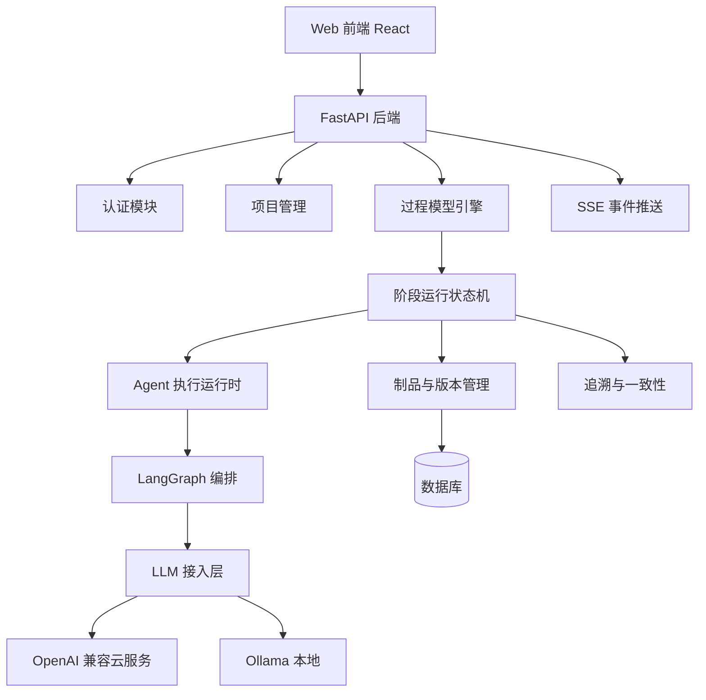
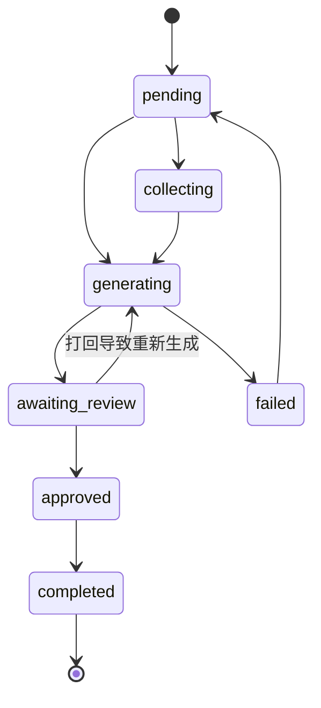

# 软件生命周期智能协作平台 详细设计文档

> 版本：v0.1  
> 日期：2026-08-21  
> 状态：待确认  

## 1. 项目概述

### 1.1 背景与目标

本项目面向软件工程毕业设计，构建一个"基于大语言模型多智能体的软件生命周期制品生成与协作平台"。用户以项目发起人身份创建项目，系统模拟软件开发团队，按软件过程模型逐阶段产出可评审、可修订、可导出的工程文档。

核心目标：

1. 需求分析 agent 与用户对话收集需求，输出需求确认清单和需求规格说明书。
2. 后续阶段支持两种参与模式：用户直接与阶段 agent 对话，或由统筹 agent 自动调度执行。
3. 每个阶段产出标准工程文档，经人工评审后才允许进入下一阶段。
4. 支持用户使用自己的第三方 API，也支持本地 Ollama。
5. 过程模型采用配置化设计，MVP 只实现瀑布模型，预留 V 模型和敏捷模型扩展能力。

### 1.2 系统角色

| 角色 | 说明 |
| --- | --- |
| 项目发起人 | 创建项目、提供需求、选择参与模式、确认评审结果 |
| 统筹 agent | 自动模式下调度阶段 agent、汇总上下文、向用户汇报 |
| 需求分析师 agent | 需求阶段访谈用户、整理需求、生成需求文档 |
| 架构师 agent | 概要设计阶段生成架构与模块设计文档 |
| 设计工程师 agent | 详细设计阶段生成类设计、表结构、接口定义 |
| 开发工程师 agent | 编码阶段生成代码骨架和数据库 DDL |
| 测试工程师 agent | 测试阶段生成测试计划、测试用例、测试报告模板 |
| 评审 agent | 对阶段产物做一致性检查和清单检查，给出通过或修改建议 |

### 1.3 设计原则

1. 数据库中的阶段运行状态是唯一事实来源，LangGraph 只负责单个阶段内的 agent 执行。
2. 每个阶段必须有用户确认关卡，自动模式也不能跳过。
3. 所有产物可版本化、可人工编辑、可导出、可追溯。
4. LLM 接入层与业务解耦，支持用户自带 key、多模型切换。
5. MVP 只做瀑布模型，但过程模型引擎必须配置化。

## 2. 范围与边界

### 2.1 MVP 包含

- 用户注册、登录、JWT 鉴权。
- 项目创建、项目列表、项目流程查看。
- 瀑布模型 5 个阶段：需求分析、概要设计、详细设计、编码骨架、测试计划与用例。
- 需求访谈对话、需求确认清单。
- 自动执行 / 直接沟通两种阶段参与模式。
- 阶段产物生成、保存、版本管理、人工评审闭环。
- Markdown 在线编辑，Word/PDF/Markdown 导出。
- 需求到设计再到测试的追溯矩阵。
- LLM Provider 管理：OpenAI 兼容云服务、Ollama。
- 项目管理看板、agent 活动日志、token 用量统计。

### 2.2 MVP 不做

- 多过程模型并行切换，只做配置预留。
- 用户作为团队成员深度参与开发流程。
- 真实代码仓库集成、CI/CD、自动部署。
- 多人实时协同编辑。
- 严格的 RBAC 多租户权限体系。

## 3. 总体架构



### 3.1 技术选型

| 层级 | 技术 |
| --- | --- |
| 后端 | Python 3.12、FastAPI、SQLAlchemy 2.0、Alembic、Pydantic v2 |
| Agent 编排 | LangGraph，固定版本锁定 |
| LLM 接入 | langchain-openai、Ollama 客户端 |
| 数据库 | SQLite（开发）/ PostgreSQL（部署），SQLAlchemy 统一访问 |
| 前端 | React 18、TypeScript、Vite、Tailwind CSS、shadcn/ui、Zustand |
| 实时通信 | SSE（服务端事件流） |
| 文档 | Tiptap 编辑器、Markdown 渲染、python-docx 导出 |
| 测试 | pytest、pytest-asyncio、Playwright |

### 3.2 模块划分

| 模块 | 职责 |
| --- | --- |
| auth | 注册、登录、JWT、密码加密 |
| projects | 项目 CRUD、项目成员、项目状态 |
| process_engine | 过程模型、阶段定义、阶段与 agent/模板绑定 |
| stage_runtime | 阶段状态机、阶段运行记录、事件流转 |
| agents | agent 角色注册、系统提示词、对话会话 |
| orchestrator | LangGraph 图定义、节点执行、上下文组装 |
| llm_provider | Provider 管理、模型管理、密钥加密、调用日志 |
| artifacts | 制品内容、版本、导出 |
| review | 评审记录、通过/打回、修订 |
| traceability | 实体解析、追溯矩阵、一致性检查 |
| events | SSE 事件协议、活动日志 |
| web | 前端工作台 |

## 4. 过程模型引擎设计

### 4.1 核心实体

| 实体 | 说明 |
| --- | --- |
| ProcessModel | 过程模型，如瀑布、V 模型、敏捷 |
| Stage | 某个过程模型中的阶段，有序号、编码、名称、进入与退出条件 |
| AgentRole | 系统内置 agent 角色注册表 |
| StageAgentBinding | 阶段与 agent 角色的绑定，标记是否为对用户接口 agent |
| ArtifactTemplate | 阶段产物模板，Markdown 形式，包含占位符 |
| ReviewRule | 阶段评审检查项 |

### 4.2 瀑布模型 MVP 配置

| 序号 | 阶段编码 | 阶段名称 | 接口 agent | 产物 |
| --- | --- | --- | --- | --- |
| 1 | requirements | 需求分析 | 需求分析师 | 需求确认清单、需求规格说明书 |
| 2 | architecture | 概要设计 | 架构师 | 概要设计说明书 |
| 3 | detailed-design | 详细设计 | 设计工程师 | 详细设计说明书、数据库设计 |
| 4 | coding | 编码骨架 | 开发工程师 | 代码目录骨架、表结构 DDL |
| 5 | testing | 测试计划与用例 | 测试工程师 | 测试计划、测试用例 |

### 4.3 扩展机制

后续增加 V 模型时，只需新增一个 ProcessModel 配置，复用同一套阶段状态机和 agent 执行运行时，前端流程条根据配置动态渲染。

## 5. 智能体与编排设计

### 5.1 两种参与模式

| 模式 | 说明 |
| --- | --- |
| 自动执行 | 统筹 agent 调度阶段 agent，用户只接收结果并评审 |
| 直接沟通 | 用户与当前阶段接口 agent 直接对话，深入参与细节 |

每个阶段开始时用户可以选择模式，也可以随时切换。自动模式下阶段结束时仍强制进入人工评审。

### 5.2 阶段状态机

阶段运行状态：

- pending：未开始
- collecting：需求访谈中
- generating：agent 生成中
- awaiting_review：产物已生成，等待评审
- approved：已通过
- rejected：已打回
- completed：阶段完成，流转到下一阶段
- failed：执行失败
- cancelled：用户取消



### 5.3 LangGraph 使用方式

数据库是状态唯一来源，LangGraph 作为阶段内的执行引擎。

图节点：

| 节点 | 职责 |
| --- | --- |
| load_context | 加载项目信息、前置阶段产物、模板、对话记录 |
| collect_requirements | 需求阶段访谈与确认清单生成 |
| call_agent | 调用当前阶段 agent 生成内容 |
| save_artifact | 保存产物并生成新版本 |
| suggest_review | 评审 agent 输出检查结果和建议 |
| finish | 结束本阶段执行 |

图的 State 只承载一次执行的临时上下文：project_id、stage_run_id、输入产物 ID、输出内容、事件缓冲区。执行结束后写回数据库，不依赖 LangGraph 做长期持久化。

### 5.4 对话协议

需求访谈和直接沟通统一使用消息表。每条消息包含：发送方、agent 编码、内容、时间。界面通过 SSE 接收增量消息。

## 6. LLM 接入层设计

### 6.1 Provider 抽象

Provider 类型：

| 类型 | 适用服务 |
| --- | --- |
| openai_compatible | DeepSeek、MiMo、Kimi、智谱、通义、vLLM 等 |
| ollama | 本地 Ollama |

统一接入接口：

```python
class LLMProvider(BaseModel):
    id: str
    name: str
    type: str
    base_url: str
    api_key_ref: str | None
    default_model: str
    models: list[str]
```

工厂函数：

```python
def create_chat_model(provider, model, temperature=0.3):
    ...
```

### 6.2 安全设计

- API Key 使用 Fernet 对称加密后存储。
- 接口返回时只显示掩码后的 key。
- 后端日志中禁止输出 key。
- 用户只能管理自己的 provider。

### 6.3 调用设计

- 所有模型调用走同一套客户端封装。
- 支持流式输出，通过 SSE 推送给前端。
- 失败自动重试，超时设置上限。
- 记录 token 用量、耗时、成本估算。
- 对可缓存的生成任务提供基于 prompt 哈希的缓存。

## 7. 数据模型

### 7.1 表清单

| 表 | 说明 |
| --- | --- |
| users | 用户 |
| projects | 项目 |
| process_models | 过程模型 |
| stages | 阶段定义 |
| agent_roles | agent 角色注册 |
| stage_agent_bindings | 阶段与 agent 绑定 |
| artifact_templates | 产物模板 |
| stage_runs | 阶段运行实例 |
| messages | 对话消息 |
| artifacts | 产物 |
| artifact_versions | 产物版本 |
| reviews | 评审记录 |
| review_checklist_items | 评审检查项 |
| traceability_links | 追溯关系 |
| llm_providers | 模型服务商配置 |
| llm_provider_models | 服务商模型 |
| llm_call_logs | 模型调用日志 |
| activity_events | 活动事件 |
| system_settings | 系统配置 |

### 7.2 关键表字段

projects：

- id、owner_id、name、description、process_model_id、status、created_at、updated_at

stage_runs：

- id、project_id、stage_id、status、mode、current_agent_id、input_artifact_ids、output_artifact_id、review_result、started_at、finished_at

artifacts：

- id、project_id、stage_run_id、type、title、current_content_md、current_version、status、created_at、updated_at

artifact_versions：

- id、artifact_id、version_no、content_md、change_note、created_at

llm_providers：

- id、user_id、name、type、base_url、api_key_enc、default_model、enabled、created_at

traceability_links：

- id、project_id、from_type、from_key、to_type、to_key、relation、created_at

## 8. 后端 API 设计

### 8.1 认证

| 方法 | 路径 | 说明 |
| --- | --- | --- |
| POST | /api/auth/register | 注册 |
| POST | /api/auth/login | 登录 |
| GET | /api/auth/me | 当前用户 |

### 8.2 项目与流程

| 方法 | 路径 | 说明 |
| --- | --- | --- |
| GET/POST | /api/projects | 项目列表/创建 |
| GET/PATCH | /api/projects/{id} | 项目详情/更新 |
| GET | /api/projects/{id}/flow | 流程状态 |
| GET | /api/projects/{id}/artifacts | 全部产物 |
| GET | /api/projects/{id}/traceability | 追溯矩阵 |
| GET | /api/projects/{id}/stats | 用量与统计 |

### 8.3 阶段执行

| 方法 | 路径 | 说明 |
| --- | --- | --- |
| POST | /api/projects/{id}/stages/{stage_code}/start | 开始阶段，指定模式 |
| POST | /api/projects/{id}/stages/{stage_code}/chat | 发送对话消息 |
| GET | /api/stage-runs/{run_id}/messages | 阶段对话记录 |
| GET | /api/stage-runs/{run_id}/review | 获取评审信息 |
| POST | /api/stage-runs/{run_id}/approve | 人工通过 |
| POST | /api/stage-runs/{run_id}/reject | 人工打回 |

### 8.4 产物

| 方法 | 路径 | 说明 |
| --- | --- | --- |
| GET | /api/artifacts/{id} | 产物详情 |
| PATCH | /api/artifacts/{id} | 人工编辑保存 |
| GET | /api/artifacts/{id}/versions | 版本列表 |
| POST | /api/artifacts/{id}/versions/{version}/restore | 回滚版本 |
| GET | /api/artifacts/{id}/export | 导出 markdown/docx/pdf |

### 8.5 Provider 管理

| 方法 | 路径 | 说明 |
| --- | --- | --- |
| GET/POST | /api/providers | 列表/新增 |
| PATCH/DELETE | /api/providers/{id} | 更新/删除 |
| POST | /api/providers/{id}/test | 测试连接 |
| GET | /api/providers/{id}/models | 模型列表 |

### 8.6 SSE 事件

GET /api/projects/{id}/events

| 事件 | 数据 | 说明 |
| --- | --- | --- |
| stage_status | stage_run_id, stage_code, status | 阶段状态变化 |
| agent_started | agent_code, stage_run_id | agent 开始任务 |
| message_delta | stage_run_id, content | 流式消息增量 |
| artifact_saved | artifact_id, version | 产物保存 |
| review_opened | stage_run_id | 进入评审 |
| review_result | stage_run_id, result | 评审完成 |
| stage_completed | stage_run_id | 阶段完成 |
| error | stage_run_id, message | 执行失败 |

## 9. 前端设计

### 9.1 页面结构

| 路由 | 页面 |
| --- | --- |
| /login、/register | 登录注册 |
| /projects | 项目列表 |
| /projects/:id | 项目工作台 |
| /providers | Provider 设置 |

### 9.2 工作台布局

顶部：项目名、流程进度条、Provider 与模型选择、用户菜单。  
左侧：流程对话、产物、追溯、统计、设置导航。  
中间：对话面板或产物编辑区。  
右侧：agent 活动日志与评审面板。

### 9.3 主要组件

- ProcessTimeline：阶段流程条，状态动效。
- ChatPanel：消息列表、流式输出、输入框。
- ArtifactEditor：Markdown/Tiptap 编辑、预览切换。
- VersionDiff：版本对比。
- ReviewPanel：通过/打回、评审意见。
- ActivityLog：agent 活动日志。
- ProviderForm：Provider 新增与测试连接。
- TraceMatrix：追溯矩阵表格。
- StageGateModal：阶段确认弹窗。

### 9.4 状态与动画设计

前端用 Zustand 管理项目级状态，SSE 事件驱动更新：

- 阶段开始时流程条高亮。
- agent 执行时右侧日志滚动。
- 内容生成时中间以流式方式显示。
- 产物保存时对应阶段节点出现版本角标。
- 评审弹出时进入等待状态。
- 通过后流程条前移，打回后回到生成态。

动画只表达真实状态，不做假进度。

## 10. 制品与知识库设计

- 模板使用 Markdown 存储，带占位符，如 {{project_name}}、{{requirements}}。
- 模板内置检查清单，生成结果按清单自检。
- 生成时先加载模板、前置产物、项目上下文，再调用 agent。
- 每次保存产物自动创建新版本。
- Word 导出使用 python-docx，PDF 导出使用 WeasyPrint 或浏览器打印。

## 11. 一致性与追溯矩阵设计

阶段产物按约定格式写入实体标记，例如：

```text
### 需求条目 RQ-001
### 用例 UC-001
### 模块 MOD-001
### 测试用例 TC-001
```

生成后自动解析并写入 traceability_links，形成：

需求 → 用例 → 设计模块 → 测试用例

追溯矩阵展示缺失关系；评审 agent 同时校验文档中是否引用了不存在或未覆盖的条目。

## 12. 非功能设计

| 方面 | 方案 |
| --- | --- |
| 安全 | 密码 bcrypt，JWT 鉴权，API Key Fernet 加密，项目归属校验 |
| 可靠性 | 重试与超时、生成状态落库、失败可重跑 |
| 性能 | 数据库索引、生成结果缓存、SSE 批量增量 |
| 稳定性 | 支持 Poll 兜底，SSE 断开后前端可恢复状态 |
| 易用性 | 全中文界面，桌面端优先，评审操作快捷 |

## 13. 测试与验证方案

- 单元测试：Provider 工厂、状态机、模板渲染、追溯解析。
- 集成测试：使用假 LLM 客户端跑完整瀑布流程，保证可确定性。
- E2E 测试：Playwright 跑三个案例项目。
- 人工评估：文档完整度、追溯覆盖率、专家评分。

## 14. 风险与对策

| 风险 | 对策 |
| --- | --- |
| LangGraph API 变化 | 锁定版本，隔离在 orchestrator 模块 |
| 生成内容幻觉 | 模板约束、检查清单、评审 agent、追溯校验、人工确认 |
| 长任务不稳定 | 状态落库、断点续跑、轮询兜底 |
| API 成本 | 开发期用 Ollama，生成结果缓存，显示用量 |
| 范围过大 | MVP 只做瀑布模型，按里程碑推进 |

## 15. 验收标准

1. 用户注册后创建项目，可选择 Provider 和模型。
2. 需求阶段可与需求分析师 agent 对话，生成确认清单并确认。
3. 自动模式下可从一个阶段推进到下一阶段，产物可导出 Word。
4. 直接沟通模式下可打回、修订、重新生成。
5. 追溯矩阵能展示需求到测试的覆盖关系。
6. 使用图书管理系统、校园二手交易平台、在线考试系统三个案例跑通完整流程。
